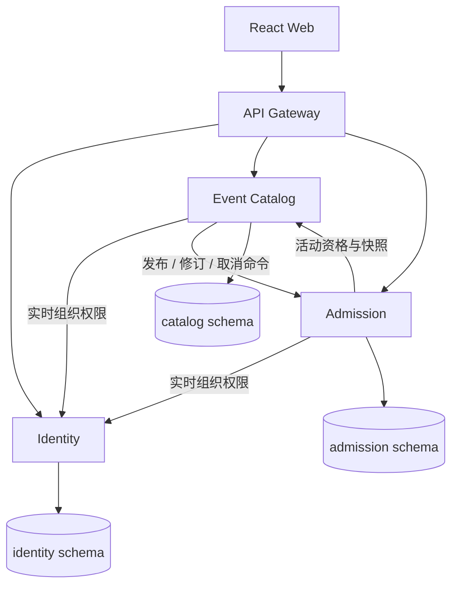

# ADR 0001：服务边界、一致性与运行方式

状态：采用。当前运行方式见 [K3s 运维](../k3s.md)，业务规则见[功能说明](../functional-guide.md)。

## 领域边界

| 服务 / bounded context | 拥有的数据与行为 |
| --- | --- |
| Identity | 账号、组织、成员关系、邀请、组织治理与成员通知 |
| Event Catalog | 活动及其组织归属、可见性、发布、版本化修订与取消意图 |
| Admission | sales/票种/库存、订单、票券、工作人员分配、核销和业务通知 |

Admission 将库存、订单、出票和核销保留在同一边界，以数据库本地事务保护一致性。按业务所有权划分服务，不为每张表拆服务。组织通过配置、成员角色和共享 API 入驻；平台 ADMIN 不自动取得组织业务管理权。

三个独立进程、镜像、Deployment 和 Service 使用独立 schema、账号、Secret 与 Flyway 迁移。共享 PostgreSQL 实例，不共享实体/Repository/外键，也不做运行时跨 schema 查询。共享实例降低当前维护成本，同时保留数据库级共同故障与容量约束。

## 本地事务与跨服务协议

Catalog 在本地持久化操作 ID、版本、目标状态、进度和错误，随后在事务外调用 Admission。Admission 校验命令指纹、取得数据库锁并在本地事务保存结果与幂等收据。相同命令重放复用结果，不同参数冲突。恢复任务继续 pending 操作，不依赖单个进程内存。

- **发布：**DRAFT → PUBLISHING → Admission 激活 sales → Catalog PUBLISHED。PUBLISHING 保持不可见，新预订还需读取 Catalog 的已发布资格。
- **修订：**Catalog 保存 UPDATING 意图，Admission 原子修改销售信息/票种并写收据，确认后 Catalog 完成；拒绝保留原状态，网络中断可恢复。详见[发布管理](../publication-management.md)和[改期协议](../schedule-revision.md)。
- **取消：**Catalog 先记录 CANCELLING，Admission 锁 sales、关闭销售、取消确认订单与未核销票、释放库存、写通知及收据，然后 Catalog CANCELLED。已签到记录保留，取消终态拒绝迟到激活。
- **组织关闭：**Identity 记录 CLOSING，Catalog 围栏拒绝新活动写入并完成已有操作，再调用上述取消；完成后 Identity 撤销成员与邀请。原请求时间为取消截止点。

远程资格检查不是数据库锁。预订在本地事务中重新检查 sales 状态/时间，取消取相同锁；先提交的在途预订会被后续取消事务处理。数据库锁内不进行远程 HTTP。

## 库存与幂等

同用户/requestKey 唯一，先用数据库 advisory lock 再锁 sales；同键同参数返回原订单，异载荷 409。订单与逐人唯一票凭证同事务生成，可售库存不为负。个人取消与签到用一致锁顺序，库存至多释放一次；核销须通过实时成员和活动分配校验，VALID → CHECKED_IN 只成功一次。

## 依赖、超时与重试

内部 HTTP 使用分方向服务令牌；公开网关拒绝 `/internal/`。Catalog 和 Admission 依赖 Identity 的实时权限，订票还依赖 Catalog。依赖不可用返回有界失败，不缓存过期角色来放行。

网关通过就绪 Catalog Pod 做读请求故障转移。Admission 对 GET 快照和只读 batch-details POST 的瞬态 502/503/504 最多重试一次；404/409 不重试，prepare-sales 等写命令不自动重放。写操作通过持久化操作 ID、请求指纹和收据恢复。当前内部 HTTP 未使用 mTLS。

## 部署与取舍

| 决策 | 当前实现与边界 |
| --- | --- |
| Kubernetes 运行 | 两节点 EC2 K3s/containerd，应用使用 OCI 镜像；Compose 仅用于本地开发和部分测试 |
| 跨节点副本 | 五个应用各两副本、节点硬反亲和、逐副本替换；第三副本需要更多节点或不同测试拓扑 |
| 数据持久化 | worker 单 PostgreSQL 和 Retain local-path；数据依赖原节点，无自动数据库切换 |
| 控制平面与入口 | 单 server/SQLite、单 Traefik、单可用区；仍有控制平面、入口和故障域单点 |
| 交付 | main 构建/扫描同批产物、GHCR digest、OIDC/SSM、备份与运行验证；应用回退不逆转 Flyway |
| 可观测性 | Prometheus、Grafana、Loki、Tempo、OTLP 和 Telegram；监控与业务共享节点资源，非独立外部探测 |
| 安全 | JWT、实时授权、内部令牌、HTTPS、Secret、schema/网络隔离和 CI 门禁；例外见[安全说明](../security.md) |

跨实例正确性、容量、扩容收益和业务恢复时间分别验证。热点 sales 行锁、同步权限查询和共享数据库可能限制扩容收益；采用[受控实验](../performance-and-availability.md)测量，不由副本数推断性能。
