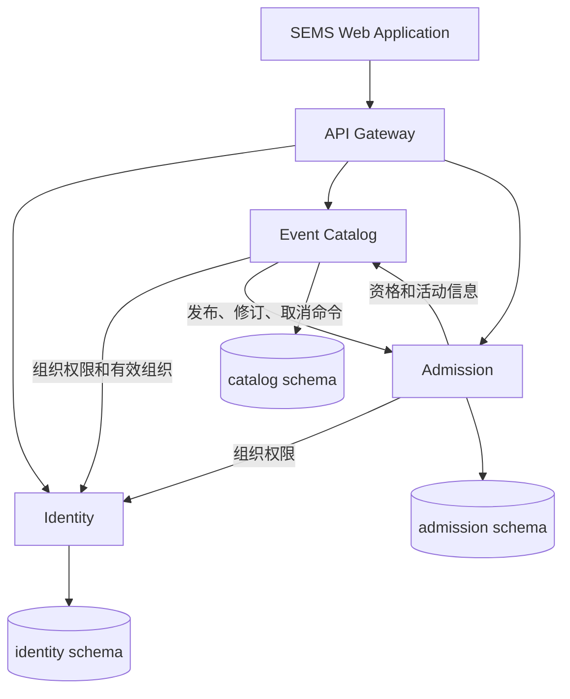

# ADR 0001：服务边界与一致性

状态：采用三服务边界；组织角色、发布/修订恢复、免费预订、票券、参与者取消、工作人员核销及基础统计已实现。整场取消及其持久化恢复协议已实现。

Identity 拥有账号、组织、成员和邀请；Catalog 拥有活动、组织归属、可见性、发布和修订；Admission 拥有销售、库存、订单、票券、人员分配、签到和业务通知。共享 PostgreSQL 时隔离 schema/凭据，不共享实体、Repository、外键或运行时跨 schema 查询。组织权限实时通过 Identity 校验，平台管理员不自动取得组织业务权限。

## 逻辑依赖与数据所有权

## 跨服务协议

Catalog 持久化操作 ID、目标版本、步骤及错误；恢复任务从 pending 操作继续。内部 HTTP 须认证，不能只依赖内网。Admission 持久化命令 ID、指纹和结果，同键同参数返回既有结果，异参数409。版本单调，取消终态拒绝迟到激活。

发布：DRAFT→PUBLISHING（不可见）→Admission activate-sales（含 owner/容量/时间/版本）→Catalog PUBLISHED。预订先查询 Catalog 是否 PUBLISHED，网络失败返回503；所以激活成功但 Catalog 未发布时不能售票。

取消：Catalog 先保存 CANCELLING 并拒绝新的 eligibility 请求，调用 Admission `/internal/v1/events/{id}/cancel`。Admission 锁本地 sales 记录，关闭销售、取消确认订单和未核销票、释放预留库存并同事务写入通知和幂等收据；完成后 Catalog CANCELLED。已核销记录保留历史。超时保持 pending，同操作ID恢复，不重新发布。

远程检查不是锁：预订完成 HTTP 校验后，在本地事务锁 sales 并再次检查销售状态/时间。取消获取相同锁；已在途预订如果先提交，由取消事务随后撤销。售票关闭提交之后不能新增有效订单。不得持数据库锁发远程请求。

已发布活动的版本化编辑与暂停/恢复已经实现，见[发布管理](../publication-management.md)和[修订协议](../schedule-revision.md)。暂停不等于整场取消。

## Admission 事务规则

- 同用户/request key唯一；同请求返回原订单，异载荷409。跨实例用数据库锁和唯一约束，不用JVM锁。
- 总配额不超过容量，可售库存非负；金额平台计算，核心仅免费票。
- 确认订单和 quantity 张唯一、不可预测的票凭证同事务生成；取消至多释放一次。
- 个人取消须未开始且无任何已签到票，与签到用一致锁顺序串行化。
- 签到验证 staff assignment、活动关联及有效票，条件更新 VALID→CHECKED_IN，成功最多一次。
- 管理操作校验活动实际组织及实时成员权限；平台 ADMIN 不默认绕过组织权限；Attendee 仅访问本人订单。

不引入消息中间件或分布式事务。网关不暴露/internal，内部调用另做认证。共享数据库和热点锁吞吐上限通过实验报告。

## 当前票种与发布实现

Admission 保存免费票种、配额、销售窗口和销售状态。首次配置经 Catalog 获取活动快照；后续详情/票种统一通过版本化 revision 协议更新，报名规则在首次发布后锁定。

Catalog 的 `PUBLISHING`、操作ID、原始请求版本、票种版本持久化在事件记录中。Admission 在同一事件数据库锁内检查快照、票种版本并激活；同操作同参数重放无副作用。明确409退回DRAFT并保存错误；超时/网络故障保持PUBLISHING，由每5秒执行的恢复任务重试。重启不会丢失待处理操作。网络调用在数据库事务外执行。

两个内部调用方向使用分别生成的服务令牌，网关不暴露内部路径。本地开发和当前云端容器间使用 HTTP；云端公网使用 HTTPS。内部传输尚未采用 mTLS，运行密钥由受限主机文件管理。预订事务已实现，同请求键先取数据库 advisory lock，再锁 sales 行；取消也先锁 sales 行，重复取消不释放更多库存。两个 Admission 副本的本地验收已覆盖 100 请求争 10 个名额与数据库结果检查，不代表已完成云端性能实验。详见 [预订设计](../functional-guide.md)。

## 部署与运行取舍

以下基于截至 2026-10-22 的发布记录；最近版本见[发布状态](../progress.md)。

| 方面 | 实现 | 限制与取舍 |
|---|---|---|
| 服务边界 | 三个独立 Spring Boot 进程、镜像和 schema 账号；跨服务使用 HTTP | 以领域所有权和本地事务划分服务，不按表数量拆分 |
| 多组织平台 | 共享账号、活动和票务能力；组织角色共享管理，跨组织校验 | 活动管理权由组织成员关系决定，不由创建者独占 |
| 多副本正确性 | 无服务器会话 JWT、数据库锁、幂等键、操作回执和恢复任务 | 本地多副本验收通过；同一活动的 sales 锁串行化热点写入 |
| 同步依赖 | Catalog/Admission 查询 Identity；订票查询 Catalog 资格 | 服务独立运行仍依赖 Identity 与数据库的可用性 |
| 部署 | 单台 Lightsail、单 PostgreSQL，Caddy、网关和三服务同机 | 增加容器不能消除宿主机、数据库和入口单点 |
| 交付 | CI 构建/扫描同次测试产物，发布 GHCR digest；主机备份、拉取镜像并用 Compose 启动，不在主机重建 | 兼容镜像回滚仍待演练；应用镜像回退不自动撤销数据库迁移 |
| 可观察性 | 网关请求日志、健康接口、Catalog/Hikari 计时和资源/数据库采样工具 | 有实验工具，尚无持续时序监控和告警 |
| 安全 | JWT、实时授权、内部令牌、外部 HTTPS、独立 schema 凭据、认证限流及 CI 扫描门禁 | 内部 HTTP 非 mTLS；密钥为主机文件，扫描例外见安全说明 |

云配置中三个 JVM 各 768 MiB、PostgreSQL 512 MiB、Web/网关各 96 MiB、Caddy 128 MiB，上限合计 3136 MiB。实际主机可能还有覆盖配置和其他服务。上限不是预留或实测内存；增加副本前需记录可用资源、数据库连接和 JVM 开销。扩容对照必须保持每副本资源、数据和请求分布一致。

跨实例正确性、容量、扩容收益和恢复时间分别验证。已有并发和重启验收不能替代受控云端扩容对照、十分钟稳态或定时恢复。具体方法见[性能与可用性实验](../performance-and-availability.md)，交付和扫描范围见 [CI](../ci.md) 与[安全说明](../security.md)，待办见[技术改进计划](../roadmap.md)。
