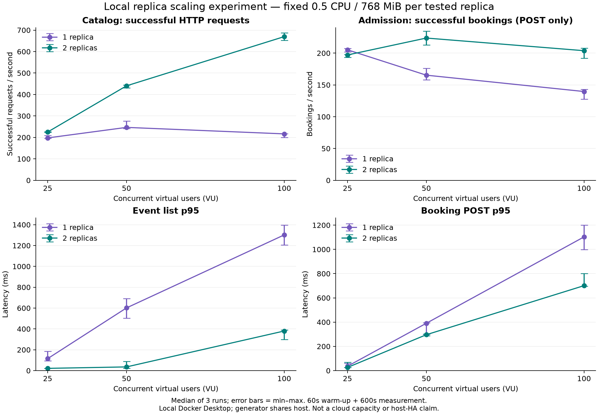
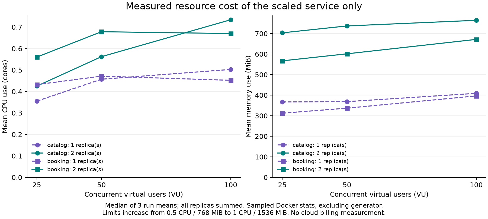

# 本地扩容与副本故障实验结果

状态：36 组有效扩容测量 + 2 组故障实验已完成。首次执行于 2026-10-19 21:54（新加坡时间）结束；三轮时间异常补测于当日 23:41 结束。补测使用原始数据库快照、相同镜像 ID 与资源限制。

## 实验条件

- 本地 Docker Desktop：aarch64、10 CPU、约 7.75 GiB 内存。负载发生器和服务共享虚拟机，其他本地容器保持运行。
- 100 个账号、100 个活动；每轮恢复相同数据库快照，刷新 1 小时 JWT。Catalog 请求比例为 80% 分页检索、20% 详情；订票场景为 POST 后读取回执，每次迭代有 0.1 秒思考时间。
- 被测服务每副本限制 0.5 CPU / 768 MiB；1→2 副本意味着总限制升至 1 CPU / 1536 MiB。其他服务固定。镜像身份、环境、快照哈希见 summary.json。
- 两类场景 × 25/50/100 VU × 1/2 副本 × 三次重复；每轮预热 60 秒、稳定测量 600 秒。顺序交错。结果不是最大吞吐容量认证，也不是云端或主机级 HA 证据。
- 下表为三轮中位数；p95 是各轮 p95 的中位数，不是合并原始请求的总体 p95。图中误差线为三次结果的最小值至最大值。

## 扩容收益

| 场景 | VU | 1 副本成功 HTTP req/s | 2 副本成功 HTTP req/s | 吞吐比 | 主要操作 p95：1→2 副本（ms） |
|---|---:|---:|---:|---:|---:|
| catalog | 25 | 197.6 | 225.1 | 1.14× | 114.9 → 21.7 |
| catalog | 50 | 246.7 | 440.4 | 1.79× | 601.6 → 35.5 |
| catalog | 100 | 216.5 | 669.6 | 3.09× | 1302.0 → 380.1 |
| booking | 25 | 410.4 | 394.2 | 0.96× | 35.8 → 26.1 |
| booking | 50 | 330.7 | 447.4 | 1.35× | 390.4 → 296.1 |
| booking | 100 | 279.3 | 407.7 | 1.46× | 1102.9 → 700.8 |

**订票场景表中是 POST + 回执 GET 的成功 HTTP 吞吐，不是订单数。** [扩容图](scaling.png) 中 Admission 面板使用 POST 成功数/秒，避免将两次 HTTP 调用误当两个订单；精确操作成绩见 [CSV](operation-measurements.csv)。

- Catalog 在 25/50/100 VU 下分别约 1.14×、1.79×、3.09×。100 VU 的超过线性结果只能表述为这组资源限制与负载下的现象；可能与单副本排队/CPU 限流等因素有关，未采集调度节流或 JVM 剖析数据，不能断言根因，也不能外推副本数量。
- Admission 在 25 VU 下约 0.96×，没有吞吐收益；在 50/100 VU 下约 1.35×/1.46×。低并发下增加副本会增加资源使用，不能宣称始终更快或更省。
- 36 组有效测量均通过既定阈值：各操作 p95 < 3000ms、意外错误率 < 1%、409 拒绝率为 0。单轮最高意外错误率约 0.0064%，并非零错误；完整失败状态与时间戳保留在 summary.json。

## 资源代价

仅统计被扩容服务的全部副本，取每轮采样均值的三次中位数。资源采样是离散 Docker stats，不覆盖 k6 负载发生器；未测量云账单。

| 服务 / VU | CPU 平均使用核数：1→2 | 内存平均 MiB：1→2 |
|---|---:|---:|
| catalog / 25 | 0.36 → 0.43 | 367 → 704 |
| catalog / 50 | 0.46 → 0.56 | 369 → 737 |
| catalog / 100 | 0.50 → 0.73 | 409 → 765 |
| booking / 25 | 0.43 → 0.56 | 312 → 567 |
| booking / 50 | 0.47 → 0.68 | 337 → 601 |
| booking / 100 | 0.45 → 0.67 | 396 → 672 |

## 副本故障与数据一致性

两组故障实验均为 25 VU：预热 10 秒、测量 180 秒；负载运行约 40 秒后强制停止一个副本，45 秒后重启。每个服务只做了一次故障实验，不能据此给出长期可用率。

| 故障对象 | 主负载表现 | 独立订票重试探针 | 数据核对 |
|---|---|---|---|
| Catalog | 目录查询未观察到失败 | 恢复阶段 12 次 HTTP 503，涉及 6 个请求键；同键补偿重试最终成功 | 125 个探针请求键对应 125 张订单，无重复 |
| Admission | 停止瞬间出现 10 次 HTTP 502 | 137 个探针请求键均成功重复提交并核对 | 137 个请求键对应 137 张订单，无重复 |

所有有效扩容与故障实验的审计均满足 `reserved = confirmed quantities = active tickets ≤ quota`。这证明本实验范围内的库存与票券一致性；不等同于所有可能的中断请求都已自动恢复。

**恢复口径必须说明：** 原执行器以“连续 30 秒错误率 <1%、各操作 p95 <3s”定义主负载恢复，两个故障实验都返回 0 秒。这表示窗口满足阈值，不表示零失败，更不覆盖另一路订票探针。Admission 的 10 次失败完成时间集中在停止请求后的约 33–36ms；这个时间段不是精确停机时长。

**原实验发现（保留原始结论）：** Catalog 副本重新启动后，订票探针出现 503，而目录查询仍成功。代码中 Admission 内部 Catalog 调用直接连接服务地址，调用失败转为 503；这与“容器已启动但依赖尚未就绪/内部客户端未切换到健康副本”的解释一致，尚需定向复现确认。应完善内部依赖的就绪路由/有界重试，仅对安全操作重试，再重跑 Catalog 故障实验。不能把当前结果描述成无损滚动恢复。

## 时间连续性复查与补测

初次三轮请求首尾跨度约 682、1661、4284 秒，最大请求空档约 82、820、1868 秒，不满足连续十分钟实验。可能涉及主机/虚拟机暂停或时钟变化，未确认锁屏是直接原因。所有原记录保留在 `supersededRuns` 和原始目录中，没有删除失败样本。

补测的请求首尾跨度分别为 599.64、599.99、599.91 秒，最大请求空档为 0.42、0.70、0.13 秒；三轮均通过时间连续性、负载阈值和库存审计。补测中一轮有 1 次失败请求，保留统计，不表述成全程零错误。
补测发生在较晚时间，虽恢复同一数据、保持相同镜像与资源，但不能消除宿主机负载随时间变化的影响。三次重复样本量有限，图中报告范围，不声称已做统计显著性检验。

## 可用于 pre / 最终报告的表述

> 在本地受控单副本资源与固定数据条件下，完成 36 组有效扩容测量和两组副本故障实验。Catalog 扩容在三个负载档位均有收益；Admission 在较高并发下获益、低并发下无吞吐提升。故障与重试后的库存和订单核对通过，但 Catalog 恢复阶段仍存在短暂订票失败，需要完善内部依赖恢复。该结果不构成云端容量、自动扩容或主机级高可用证明。

## 证据与复现

- [完整结构化结果](summary.json)、[逐轮 HTTP 成绩](measurements.csv)、[逐操作成绩](operation-measurements.csv)、[原始文件哈希](raw-manifest.json)。
- 页面保留 PNG 图；需要矢量 PDF 时运行 `plot-local.py` 重新导出，生成副本由 Git 忽略。
- 本地压缩原始日志保存在仓库忽略目录 `.performance/`，不上传凭据、数据库快照或大体积压测记录。
- 工具：`scripts/performance/local-experiment.py`、`summarize-local.py`、`plot-local.py`。绘图需要 Matplotlib。本报告已随历史 PR 合并；后续代码修复不改写原实验结果。

## 后续代码修复（2026-10-20）

Admission 已改经内部网关调用 Catalog，安全读请求支持有界副本切换。独立定向回归完成 1638 次订票及同键重放/实时回执，无失败；全 Catalog 停机及恢复后的幂等、库存检查通过。详见[当前进度](../../progress.md)。这次回归没有重跑本报告的完整矩阵，不能替换原故障数据，也不构成主机级 HA 证明。
