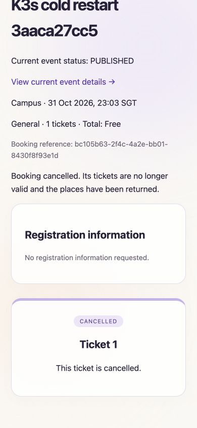

# K3s 业务与故障回归

2026-10-24，在独立的 `sems-k3s/sems-test` 环境，通过真实 HTTPS、两个 EC2 节点上的应用 Pod 和 PostgreSQL 执行。最终结果：**12 个业务套件、9 组跨节点检查、4 组 Catalog 故障检查、12 组浏览器检查通过**；前端 141 项测试、构建与 lint 通过。结构化总结果见 [summary.json](summary.json)。这些数字属于不同验证范围，不相加为单元测试数或覆盖率。

应用继续使用 `fb27bbf` 发布的不可变镜像，运行代码与源提交 `d3002d1` 一致；本轮没有修改或重新构建业务应用。实际 imageID、清单 SHA256、Admission Pod/节点分布和 Kubernetes 版本见 [cross-node-acceptance.json](cross-node-acceptance.json)。

## 方法与范围

业务适配器复用现有业务断言，将旧测试中的 SQL、服务停启和重启操作转换为真实的 `kubectl exec`、Deployment 缩放与滚动重启。执行不需要 Docker daemon 或 Compose；两个节点实际运行 `containerd://2.3.4-k3s1.36`。每个业务套件独立进程、唯一测试数据、串行执行，结束时恢复原副本数。恢复测试另行强制删除 Pod，并核对数据库。

测试前已导出数据库和不含密码的角色定义到本机受限目录，[pre-test-backup.json](pre-test-backup.json) 仅保存元数据。原 Lightsail 应用、正式域名及原站数据均未改动，测试数据没有替代原站数据。

## 业务回归

| 套件 | 重点 | 最终结果 |
|---|---|---|
| business-fixes | JWT 一小时、并发移除最后管理员保护、分页边界、最新信息与历史快照、核销时间窗口、Catalog 降级、认证限流 | 通过 |
| organization | 从发布、订票、资料校验、预登记、工作区、改期、联系人、统一编辑到组织协作的完整链路；含中断恢复和并发核销 | 通过 |
| catalog-read | 公共/内部投影字段、分页总数、私有可见性、即时停用及受保护诊断 | 通过 |
| organization-security | 邀请过期、即时提权/降权、工作人员撤销、平台管理员隔离 | 通过 |
| event-directory | 全目录搜索、字面通配符、跨页检索、协作编辑与版本冲突 | 通过 |
| organization-management | 组织总览口径、活动/成员组合筛选与分页、订票核销取消、已结束活动保护、专属夹具清理 | 补测通过 |
| visibility | 公开/组织内活动可见性、成员状态及权限即时生效 | 通过 |
| notifications | 邀请收件箱、订票/取消去重、修改与 outbox 重放、双副本开售提醒、已读与归属 | 通过 |
| membership-notifications | 任命、角色/状态变更、邀请接受与重复操作通知去重 | 通过 |
| organization-governance | 组织申请与审批、并发版本、关闭与软删除、账号和历史保留 | 通过 |
| event-cancellation | 订票/核销/个人取消竞争、整场取消、事务失败回滚、中断恢复、确认丢失后的重放 | 通过 |
| predeployment-fixes | 旧 JWT 即时撤权、成员分页、组织关闭围栏、待处理改期与关闭协作、跨服务重启恢复 | 通过 |

[首次完整执行](initial-run/summary.json) 保留 11 个通过和 1 个测试工具失败。组织管理套件最初在业务断言执行前失败：运行器目录中的 `secrets.py` 遮蔽 Python 标准库。修正测试运行器的导入路径后，[单独补测](retry/summary.json) 7 组检查全部通过，业务断言未改动。首次失败日志、修正后日志和各断言脚本 SHA256 均保留。

## 跨节点并发与持久化

[最新九组检查](cross-node-acceptance.json) 直接把请求分配到两个不同 EC2 节点上的 Admission Pod：

- 同一请求键发起 20 次请求，每 Pod 10 次，最终只有一个订单；不同载荷重复请求被拒绝。
- 100 个不同请求竞争 10 个名额，每 Pod 50 次，结果为 10×200、90×409。独立 SQL 核对库存/确认数量/有效票数为 **10/10/10**。
- 10 次并发核销只有一次首次核销，核销时间一致。
- 个人重复取消仅释放一次库存；整场取消清空可用票并保留核销历史与取消回执。
- 三个角色的 schema 边界、public CREATE 拒绝和实际跨 schema 查询拒绝通过。

## Catalog 故障与恢复

[catalog-recovery.json](catalog-recovery.json) 记录三条并发工作流持续 75 秒，每次依次订票、同键重试、读取最新回执。流量开始后强制删除一个 Catalog Pod：

| 检查 | 实测结果 |
|---|---|
| 订票 | 707 笔成功，失败 0 |
| 对应重试与实时回执 | 全部通过，合计 2,121 次业务 HTTP 操作无失败 |
| 替代 Pod Ready | 单次观察值 36.398 秒 |
| Identity、Admission、Gateway Pod UID | 全程不变 |
| 全部 Catalog 副本停止 | 新订票返回 503，单次请求耗时 0.058 秒 |
| Catalog 恢复后重试同一请求 | 返回 200，仅一个订单；未重启 Gateway |
| SQL 审计 | 库存/确认数量/有效票数 **708/708/708**，重复请求键 0 |

这证明本轮负载及故障场景下的正确性，36.398 秒是单次 Pod 替换观察值，不能作为主机故障恢复 SLO。

## 前端与真实浏览器

[frontend.json](frontend.json) 及对应日志记录 27 个测试文件、141 项测试通过，包含既有相机流释放/切换、分页回退和错误处理回归；生产构建与 lint 通过。

[browser/browser.json](browser/browser.json) 记录 Chrome 实测：注册进入工作区、未授权角色空状态、390px 无横向溢出、分类下拉框边界与选择、关键词检索、保存及删除预登记、报名确认、二维码渲染、取消后票券失效且隐藏二维码，以及两条通知与批量已读。浏览器测试订单已取消，预登记已移除，测试会话已退出，视口恢复。

其余截图：[移动目录下拉框](browser/mobile-directory.jpg)、[无组织成员权限](browser/organizations-empty.jpg)。本轮未用实体手机重新验证摄像头、扫码识别率或系统权限。

## 最终状态与边界

[final-state.json](final-state.json)：五个应用 Deployment 均为 2/2，就绪 Pod 共 11 个（含 PostgreSQL），两个节点 Ready，数据库 PVC Bound；首页、Gateway 及三个后端健康接口均通过可信 HTTPS 返回 200。

本轮保留独立测试库中的唯一夹具账号、组织、活动及历史记录；组织管理套件自身完成专属活动/组织清理，其余结果可供审计复查。未执行旧数据迁移、正式域名切换、新镜像升级回滚、主机级故障、完整灾难恢复或高 VU 容量实验。此前 250 VU 混合负载的服务端门槛未通过，不能据本轮功能回归宣布已解决；500/1000 VU 和十分钟稳态仍未验证，见[既有容量记录](../2026-10-22-cloud-capacity/README.md)。

复现命令与测试环境限制见 [K3s 操作说明](../../k3s.md)。
