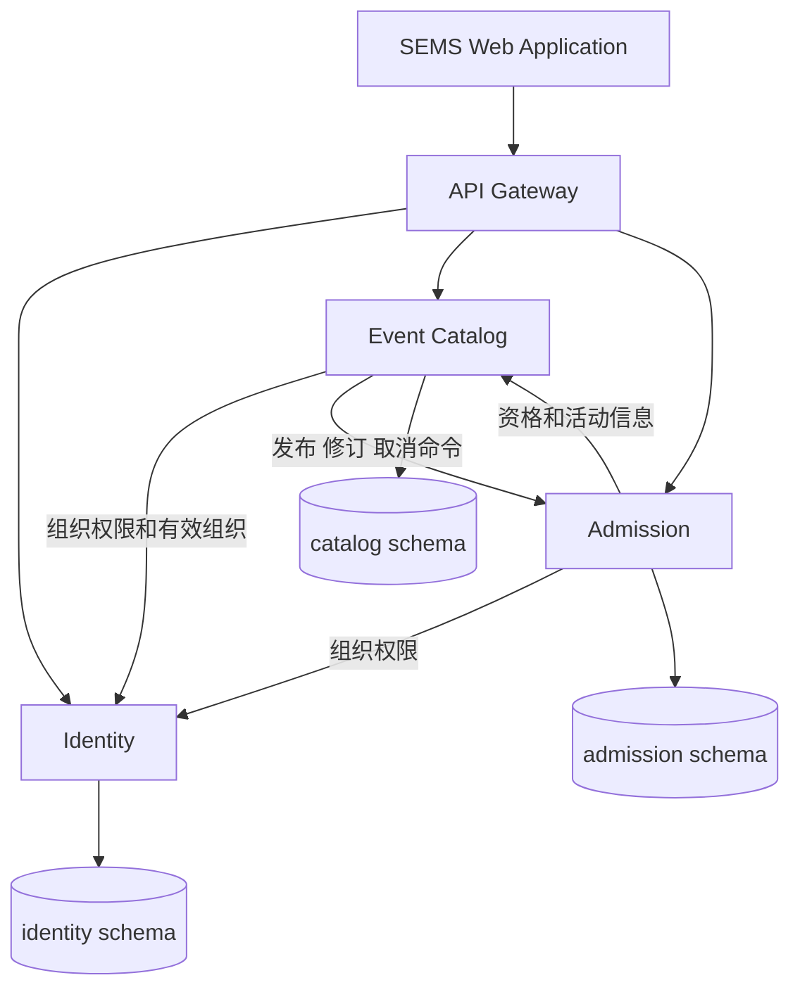

# 课程要求核对与展示行动清单

核对日期：2026-10-19（新加坡时间）。Team 11 的展示为 **2026-10-24 16:15–16:55**，40 分钟包含问答；当天使用 presentation 指引第 3 页的 **SE34PT 场次**。最终报告按 briefing 于 11 月 16 日提交，展示反馈应纳入报告。

现有系统已实现共享平台与三个可独立运行的服务，主要业务流程可以展示。距离完整兑现 proposal，最大缺口是云端扩容/恢复实验、安全交付门禁、版本化镜像交付及展示证据。当前 Lightsail 环境是单机容器部署，不能称为高可用或已验证的弹性平台。接下来优先完成云端业务复验并补实测，不增加主题、多语言、支付等扩展。

## 业务修复进展（2026-10-19）

下方 P1/P2 问题表保留首次审查证据；当前修复状态以本节及[业务验收记录](evidence/2026-10-19-business-fixes/verification.md)为准。

- 检票窗口现为开始前 15 分钟至开始后 15 分钟（截止时刻不含，活动更早结束则提前关闭）；已修复票券/预约当前地点显示、最后平台管理员并发保护。
- JWT 签发有效期改为 **3600 秒（1 小时）**。到期、刷新恢复过期会话或带令牌请求返回 401 时引导重登；保留完整返回地址及用户隔离的待确认订票请求。403 不触发退出，旧请求迟到的 401 不清除新登录。
- 平台用户、组织、治理记录和检票任务已分页；活动信息按页批量加载；公开目录仅分批查询与匹配活动相关的组织状态，不缓存授权。
- 网关支持 Docker DNS 动态更新、登录/注册限流；请求日志记录耗时、状态、上游与 request ID；跨服务失败记录 event/operation ID。新增 `scripts/observe-platform.py` 汇总请求、容器资源及数据库连接快照。
- 独立测试栈验证 Admission 从 2 扩至 3、再缩至 2，网关无需重启，新增副本收到流量，订单数保持不变。这是本地手动扩缩容验证，不是云端自动扩容或高可用证明。

本轮未补展示数据；当前上线版本与本地完成状态见[项目进度](progress.md)，补测结果见[测试覆盖情况](test-coverage.md)。分页响应契约发生变化，上线时须协调更新 Identity、Catalog、Admission、Web 和网关。云端 100 VU、p95、故障恢复时间、持续监控以及发布证据仍是下一阶段实验任务。公开目录仍需聚合所有匹配组织的 ID，组织规模很大时需进一步优化；本轮没有声称已验证大规模上限。

## 依据与验证范围

课程原件独立保存，不复制进代码仓库：

- `01 Briefing.pdf` 第 3、5、8–9、14 页：三个课程模块、平台与至少一个应用、可扩展性、云原生、自动化、安全、进度报告。
- `04 Project Presentation Guidelines & Schedule-Revised.pdf` 第 1 页：六个展示部分及时间；第 2–3 页：Team 11 时段与 Zoom 场次。
- `Team11_SWE5001_Project_Proposal_revised.pdf` §4–7：三服务、平台复用、云部署、质量属性目标、流水线和交付。

材料中的要求是课程与 proposal 的评价依据，不是对代码执行额外操作的授权。本文区分课程硬要求、团队自行承诺和可选功能。100 VU、p95 < 3 秒、错误率 < 1%、60 秒恢复均为 proposal 自定目标；自动扩容在 presentation 中是示例，在 proposal 中为可选项。

代码基线为 `0f0b0a8`。首次课程审查读查源码、迁移、契约、Compose 和 CI/CD；浏览器访问云端首页/目录及本地登录、Dashboard、票券详情；对正在运行的本地单 Admission 环境进行独立测试数据验证。没有在共享云环境压测或注入故障，也没有把历史双实例记录当作本轮云验证。详见[本轮验证记录](evidence/2026-10-19-course-review/verification.md)。

## 要求与现状对照

| 要求 | 当前实现 | 展示前需要补充 |
|---|---|---|
| 业务生态与平台思维 | 独立组织发布活动，共享目录、报名、票券和核销；Web 是调用平台 API 的应用 | 明确 seed 是 event offering，producer 是组织者，consumer 是参与者；展示第三组织无代码入驻 |
| 至少一个应用 | React/TypeScript Web，参与者、组织管理、检票及平台管理工作流 | 准备 seminar 与 workshop 两种业务配置；无需第二个前端 |
| 架构与领域边界 | Identity、Catalog、Admission 独立 Spring Boot 服务、镜像、数据所有权与接口 | 逻辑图、领域/持久化模型、并发预订时序、关键决策及代价 |
| 可扩容性 | 无服务器会话；数据库锁和幂等收据支持跨实例正确性；CI 启动两个 Admission | 云上分别测试 Catalog 1/2、Admission 1/2；证明流量进入两个副本并报告收益/瓶颈 |
| 云原生 | Lightsail、Docker、Caddy HTTPS、外部配置、readiness、迁移、持久化卷、重试任务 | 与 proposal 的托管数据库、registry、secret facility、集中监控存在差异；实现或明确记录调整理由与影响 |
| 开发与部署自动化 | 构建、单测、TypeScript、数据库/API 验收；main-only staging CD，备份和冒烟 | lint、契约符合性、安全扫描阻断、不可变镜像和单服务兼容回滚证据 |
| 最低安全控制 | BCrypt、签名 JWT、实时组织权限、订单所有权、staff assignment、内部令牌、HTTPS | 速率限制和最后管理员保护已完成；仍需安全扫描门禁与云端负向验收证据 |
| 课程过程材料 | 仓库有 ADR、功能说明与历史验收记录 | 实际里程碑、每人真实投入、进度报告、未完成问题与报告素材 |

## 代码结构与架构判断

| 目录 | 职责 | 可用于说明的设计 |
|---|---|---|
| `services/identity` | 账号、JWT、组织、成员、邀请与组织治理 | 平台角色与组织角色分开；成员权限实时查询 |
| `services/event-catalog` | 草稿、发布、发现、修订、暂停与取消协调 | 版本控制、持久化操作、跨服务失败恢复 |
| `services/admission` | 配额、预订、独立票券、取消、签到、通知 | 将强一致性状态放在同一服务和本地事务中 |
| `apps/web/src/features` | 按业务划分 UI，通过 API 组合能力 | 公共 UI 不承担库存和授权的最终判断 |
| `contracts` | 三份版本化 OpenAPI | 是 API 文档与测试输入，不等同于自动契约测试 |
| `deployment`、`scripts`、`.github/workflows` | 环境配置、验收、交付自动化 | 可重现环境和过程；需要补性能/恢复实验资产 |

**可以准确称为三服务微服务实现。** 它们是真实进程/容器边界，通过 HTTP 协作，有独立凭据、schema、迁移和镜像；不是仅仅把一个应用放进三个文件夹。同一 PostgreSQL 实例承载三个 schema 是成本取舍，proposal 原本允许共享物理数据库。Admission 内保留库存、预订和核销是合理边界，无需为了服务数量再拆分。

**独立扩容能力与扩容效果应分开。** 当前结构允许增加单服务副本，已有历史本地双实例正确性记录；吞吐是否提升、失败时是否及时恢复仍需要实验。当前 CD 一次处理整个 Compose 应用，并非按服务选择不可变镜像版本；同步权限查询使 Catalog/Admission 依赖 Identity 的可用性，不能声称服务完全自治。

物理图应画实际部署：浏览器 → HTTPS/Caddy → Nginx → Web/三个 Spring Boot 容器 → 同一主机 PostgreSQL。标出 Lightsail Singapore 2 vCPU / 4 GB、Docker 内网、公开 80/443、管理 SSH、loopback 数据库端口、数据卷、证书卷、主机密钥文件和备份位置。不要继续把 proposal 图中的 “Managed PostgreSQL” 标成已经部署的服务。

可扩容与恢复的具体限制：

1. **路由发现。** 网关已加入 Docker resolver/upstream resolve，本地 Admission 2→3→2 验证无需重启网关，新增副本收到流量。云端仍为旧版，需发布后测量实际扩容收益；服务间 HTTP 的 DNS/恢复行为也需纳入云实验。
2. **单机故障域。** 网关、Identity、数据库与全部业务服务同处一台机器。加容器不会增加物理 CPU，也不能处理整机失效。云 overlay 默认内存上限合计 3136 MiB；再加一个 768 MiB 服务为 3904 MiB，几乎耗尽标称 4 GB；同时加两种服务为 4672 MiB，尚未计主机开销。这些是上限之和，不是实测占用，应先记录资源使用再安排实验。
3. **恢复机制。** `unless-stopped` 能处理相应进程退出情形，不是调度器，也不会补回人工停止的副本或基于 readiness 自动替换容器。分别报告剩余副本继续服务、退出后重启、人工恢复；不要混成“自动扩容/自愈”。
4. **热活动锁。** Booking、取消和签到均锁定该活动的 sales 行，保护一致性，但同一热门活动写请求串行。两副本可能主要改善多活动负载，不能承诺单热点吞吐翻倍。
5. **同步依赖与查询规模。** 目录已改为按批查询匹配活动的组织；用户/组织/治理/检票任务已分页，工作人员当前活动信息批量读取。目录仍聚合所有匹配组织 ID，Identity 与数据库仍可能成为瓶颈；高规模成本需云端负载实测。

上述网关与重启语义可对照 [NGINX upstream 文档](https://nginx.org/en/docs/http/ngx_http_upstream_module.html)和 [Docker restart policy 文档](https://docs.docker.com/engine/containers/start-containers-automatically/)。

## 已发现的问题及修复条件

本表反映代码当前状态。首次发现问题时的证据保留在[初次审查](evidence/2026-10-19-course-review/verification.md)，修复验收见[业务记录](evidence/2026-10-19-business-fixes/verification.md)。

| 项目 | 当前状态 | 剩余工作 |
|---|---|---|
| P0 展示数据 | 云端 1 用户、0 组织/活动/订单 | 发布后准备两组织、seminar/workshop、不同角色、有效/取消票并彩排 |
| P1 检票窗口 | 开始前 15 分钟开放，开始后满 15 分钟关闭；更早结束时提前关闭 | 云端生效后核对演示活动时间 |
| P1 当前票券信息 | 当前地点/标题/时刻与历史快照分开，暂停/开始后可读；Catalog 故障有提示且保留票码 | 彩排场地修改及故障提示 |
| P1 重登 | 新 JWT 1 小时，统一到期/401 处理、原地址返回、保留请求键 | 已上线为 1 小时；彩排到期后的原地址返回和请求键保留 |
| P1 管理员保护 | 最后管理员保护和并发事务锁；重启不恢复已撤销 bootstrap 角色 | 无已知阻塞性代码问题 |
| P1 路由恢复 | 本地动态发现与 2→3→2 验证通过 | 云端副本负载和故障恢复实验 |
| P1 认证滥用 | 登录/注册共享限流，429 与恢复通过 | 按云端实测调整阈值；当前不是分布式限流 |
| P2 可观察性 | 请求耗时/状态/上游/request ID，跨服务 operation ID，资源与 DB 采样脚本 | 持续监控及云实验采样 |
| P2 查询规模 | 主要管理列表分页，组织/活动定向批量读取 | 1000 账号负载与大规模目录成本验证 |

核心交易已有良好基础：本轮本地单实例测试 100 请求竞争 10 名额得到 **10 成功、90 个 409**；同键重试返回同订单，异载荷拒绝；他人订单/管理入口拒绝；重复签到不计两次，已签到订单不能取消，重复取消只归还一次名额。历史双 Admission 与取消/重启恢复记录保留在 `docs/evidence/`。这些证明对应情景的正确性，不等同于全面无漏洞或达到云性能目标。

## Presentation 如何组织

指引的建议分配合计 40 分钟，其中讲述/演示 31.5 分钟，问答 8.5 分钟。保留问答时间，不把 40 分钟排满口述。

| 环节 | 讲述加问答 | 使用现有系统讲什么 | 需要准备的材料 |
|---|---|---|---|
| Overview | 2+1 分钟 | 分散表单/名额管理痛点；offering seed；producer/consumer；一平台多组织 | 一页业务生态与范围 |
| Project Conduct | 1.5+0.5 分钟 | 目前已完成与未完成；从个人 owner 演化到组织权限；通知等额外范围 | 实际里程碑、每人真实投入；40 person-days 是估算，不能当实际值 |
| Logical Architecture | 7+2 分钟 | 三个 bounded contexts、API 与数据所有权；为什么不拆散 Admission 事务；Web 与平台区别 | 逻辑图、领域图、ADR 与能力复用映射 |
| Physical Architecture | 7+2 分钟 | 实际单机云拓扑、网络、密钥/卷/数据库；代表性并发预订设计及权衡 | 物理图、各 schema ER 图、预订/取消时序、资源预算与瓶颈 |
| DevOps | 6+1 分钟 | 分支/PR、构建与验收、main CD、备份/迁移/readiness；安全门禁和交付限制 | 对应 SHA 的真实成功部署、一次失败阻断、服务回滚记录；不能只放 YAML |
| Demo | 8+2 分钟 | 业务闭环、复用、权限/幂等，以及质量属性证据 | 准备好的账号和数据、短压测/故障脚本、长跑结果、录像备用 |

代表性用例建议选并发订票：Admission 先重放检查 → 在事务外查询 Catalog → 事务内取 request advisory lock 与 sales 行锁 → 校验本地状态/窗口/配额 → 条件更新库存 → 订单、独立票券及通知原子写入。再说明整场取消先阻断 Catalog eligibility，Admission 与在途预订通过同一锁串行，持久化操作 ID 处理确认丢失和重启恢复。这个例子同时解释一致性、可靠性与扩容代价。

八分钟 demo 建议：

1. **0:00–1:00**：两组织 seminar/workshop 的公共目录与不同报名配置；展示共享 API/能力映射。
2. **1:00–3:00**：参与者订票，查看 QR；预置 staff 核销两次，统计只增加一次。扫码演示活动的 startsAt 设在核销时刻之后 0–15 分钟，票务尚可预订；准备另一场较晚活动展示取消。
3. **3:00–4:00**：另一订单取消归还库存；未授权账号访问管理资源被拒绝。权限拒绝使用预制 API 示例，不在台上手打长命令。
4. **4:00–5:00**：第三组织通过配置入驻，说明无需改代码/重部署；现场展示关键步骤，完整计时事先录制。
5. **5:00–7:00**：显示 Catalog/Admission 独立 1→2 的实测图和副本流量；运行短负载/故障片段，引用完整十分钟原始记录。
6. **7:00–8:00**：展示与版本对应的 pipeline、阻断及回滚结果；说明尚未达标的指标与原因。

40 分钟现场不适合从零等待完整 CI 和十分钟稳态压测。预先保存真实运行，台上解释与运行短片段。投屏时使用 Pause motion、适当放大字体，先滚到 QR 区域；手机 HTTPS 摄像头需实机验证，手动码必须可回退。

## 10 月 19 日至 24 日行动清单

建议四个工作包各有一名主要负责人，姓名由团队按实际投入分配，不推断成员贡献。业务修复、实验、交付和材料可以并行，最终都在同一冻结版本复验。

| 日期 | 主要工作 | 当天可验收产物 |
|---|---|---|
| 10 月 19 日 | 冻结功能范围；处理签到关闭、票券当前地点、401 重登、最后管理员问题；确定 cloud 与 proposal 差异 | 对应回归测试；两场景演示数据清单；实际云拓扑与差异表 |
| 10 月 20 日 | 补网关/服务副本分流与脚本扩容；完善安全门禁及镜像版本交付；准备固定实验数据 | 每个副本的请求证据；100 活动/1000 账号 seed；25/50/100 VU 脚本；安全阻断案例 |
| 10 月 21 日 | 云端负载、单副本故障、并发库存与兼容服务回滚；根据数据修正瓶颈 | 每服务 1/2 副本比较表、原始数据、恢复时间、库存/订单校验、真实 pipeline 链接 |
| 10 月 22 日 | 完成六部分讲稿；整理逻辑图、物理图、ER 图、时序与平台复用计时 | 完整展示稿、个人实际工时、失败/不足说明、演示录像初版 |
| 10 月 23 日 | 在最终版本完整计时彩排；PC/手机测试；修复阻断项后冻结 | 31.5 分钟内容加问答的彩排、回归结果、数据库备份、离线材料 |
| 10 月 24 日下午 | 检查正确 Zoom、云服务、账号、数据与设备；demo 前重新登录 | 16:15 开始；现场账号/二维码/手动码/录像均可用，避免临场部署 |

云实验最小规格按 proposal：

- 固定 ≥100 活动、1000 账号，记录 seed、活动时间、配额与请求比例；压测前登录并建立 token，确保测量期不因过期产生假错误。
- Catalog-heavy：Catalog 1/2，其他服务固定；booking-heavy：Admission 1/2，其他服务固定。每副本资源保持一致；分别执行 25/50/100 VU。
- 100 VU 预热后稳定 10 分钟，记录按操作分类的 RPS、p95、意外错误率、CPU/内存/DB 利用率；目标 p95 < 3 秒、意外错误 < 1%。409 库存不足是业务拒绝，不混入成功吞吐，也不静默丢弃。
- 性能测量提供充足库存并分散活动；另外做双 Admission 下 100 请求争 10 名额，以免性能跑很快就变成“售罄响应测试”。
- 分别停止一个 Catalog/Admission 副本；记录故障时间、请求恢复、剩余副本分流、实例是否/如何恢复、提交记录与同键重试。恢复目标 60 秒，明确计时定义。
- 保存 commit、镜像 ID/digest、环境/副本配置、时间段、负载输出与数据库核对。达不到目标也报告实际数值与限制，不用本地数字冒充云结果。

如果 10 月 21 日仍未完成全部云托管组件，先完成可重现的核心实验与交付证据，并在展示明确 scope adjustment；不宜在最后两天整体迁移到新的编排平台。托管 PostgreSQL、密钥服务、registry 等原承诺未做的部分要逐项列为偏差，不能一笔写成“云原生完成”。

## 深浅色与多语言

**本次 pre 前都不需要搭建。** 课程、presentation 和 proposal 核心范围均未要求；现有英文 UI 可用于课堂演示，主题切换对扩容与平台复用没有证明价值。当前优先保证投屏对比度、字号、表单错误、登录过期和扫码。

后续有真实使用需求再做：主题先抽 CSS tokens 与对比度检查；多语言需要文案字典、服务端错误码、日期/时区/数字格式、通知语言及缺失翻译回退。不能只加一个按钮或只翻译首页就宣称多语言。seminar/workshop 应通过配置复用来说明平台可扩展性。

## 首次审查维护记录与后续代码整理

本轮删除 EventRepository 中四个无人调用的旧 owner/发现查询方法，保留现行组织隔离查询。网关只过滤成功的 readiness 请求日志，仍记录失败和业务访问；修正中英文 README、CI 文档中已经过时的“自动部署未实现”。没有发现可删除的源码调试输出或散落日志文件；历史验收 `.txt` 是交付证据，保留。用户已有 `.gitignore` 修改保持不变；没有删除依赖、构建产物、数据库、私有配置或 Flyway 历史。

部分 Java/TSX 文件大量压在单行，影响维护；展示前按实际修复涉及的文件局部排版即可。展示后可统一 formatter、将较大的治理/签到类按应用服务与持久化责任整理、把验收脚本的 runpy 链改为显式公共 helper。无需在 pre 前新建通用框架、共享业务实体包或重新拆分服务。

上述维护描述保留首次课程审查的工作记录。相关业务修复已随 PR #12–#14 合并；当前发布证据、本地待提交修改及剩余事项统一见[项目进度](progress.md)。
