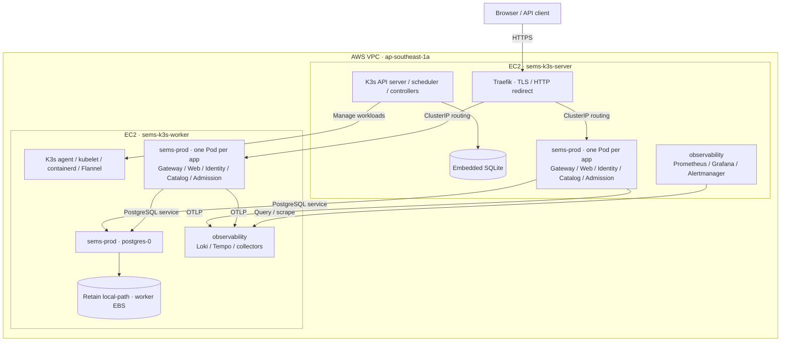

# EC2 K3s 运维

正式站点 <https://swe5001.seventh720.com> 运行在 AWS 新加坡区域的两台 EC2，使用 K3s 和 containerd。业务及 PostgreSQL 位于 `sems-prod`，监控位于 `observability`。应用发布见 [CI/CD](k3s-cd.md)，指标、告警、日志和追踪见[可观测性](observability.md)。

## 物理部署

| 项目 | 配置 |
| --- | --- |
| 区域 / 可用区 | `ap-southeast-1` / `ap-southeast-1a` |
| 网络 | 现有 VPC `vpc-02bd49f7852b0db8a`，同一默认子网 |
| 节点 | 两台 `t3.medium`，每台 2 vCPU、4 GiB 内存、30 GiB gp3 根盘 |
| Server | `sems-k3s-server`，公网 `13.229.121.219`，私网 `172.31.33.16` |
| Worker | `sems-k3s-worker`，公网 `54.151.244.167`，私网 `172.31.39.232` |
| 平台 | Ubuntu 24.04、K3s `v1.36.5+k3s1`、containerd |
| 节点分组 | 自建节点标签 `sems.io/node-group=apps`，角色为 server / worker；未使用 EKS managed node groups |



节点同时运行应用。Server 提供单控制平面及 SQLite；worker 上的 PostgreSQL 为独立 StatefulSet。五个应用各两个副本，使用节点硬反亲和分散；Pod 级 requests/limits、探针和滚动策略见 [K3s overlay](../deployment/k8s/overlays/k3s/)及[公共资源](../deployment/k8s/base/)。Node Exporter 与日志采集器在每节点运行。

Traefik 单副本在 server，通过 ServiceLB 暴露 80/443；当前正式 DNS 指向 server。两个节点处于同一可用区，数据库、本地卷、控制平面、入口和监控存在单点。应用多副本不等同于这些层面的 HA。

## 网络与访问

节点私网通过 Flannel VXLAN 通信，Pod 网段为 `10.42.0.0/16`，Service 网段为 `10.43.0.0/16`。安全组入站：

| 端口 | 来源 / 用途 |
| --- | --- |
| TCP 22 | 管理者公网 IP，SSH |
| TCP 80/443 | 公网网站与证书验证 |
| TCP 6443/10250 | 节点安全组自身，Kubernetes API / kubelet |
| UDP 8472 | 节点安全组自身，VXLAN |

Kubernetes API 和 PostgreSQL 不开放公网。应用通过 ClusterIP 和 Kubernetes DNS 发现服务；`event-catalog-pods` headless Service 仅返回就绪 Catalog Pod，供内部只读请求故障转移。公开 `/internal/` 返回 404，内部 API 另需服务令牌。数据库网络策略只允许对应应用、指定备份工具和监控 exporter。

Cloudflare 的 `swe5001` 与 `grafana` A 记录指向 server，使用 DNS only。Traefik 使用 Let's Encrypt HTTP-01，HTTP 重定向 HTTPS。ACME 状态存于 server 的 Retain PVC。公网 IP 若在停启后变化，需协调 DNS、SSH 信任记录和管理配置。证书与代理设置见[监控域名说明](observability.md#域名与-cloudflare-代理)。

## 集群管理

维护者使用私有 SSH 密钥、已核对的 known_hosts 与专用 kubeconfig；这些文件不随仓库分发。先保持以下隧道运行：

```bash
ssh -N -i .secrets/k3s-cloud/ssh.pem \
  -o IdentitiesOnly=yes -o StrictHostKeyChecking=yes \
  -o UserKnownHostsFile=.secrets/k3s-cloud/known_hosts \
  -L 127.0.0.1:16443:127.0.0.1:6443 ubuntu@13.229.121.219
```

另开终端，显式指定 context，避免依赖默认集群：

```bash
sems_kubectl() {
  kubectl --kubeconfig .secrets/k3s-cloud/kubeconfig --context sems-k3s \
    --cache-dir .secrets/k3s-cloud/cache "$@"
}
sems_kubectl get nodes -o wide
sems_kubectl -n sems-prod get deployments,statefulsets,pods -o wide
sems_kubectl -n observability get pods
sems_kubectl get ingress -A
sems_kubectl top nodes
```

节点安装脚本为 [install-k3s-node.sh](../scripts/k8s/install-k3s-node.sh)，server/agent 配置示例位于 [deployment/k3s](../deployment/k3s/)。初始化新集群需先配置节点私网、受限 API、加入令牌及独立凭据；已有生产环境通过 [CD](k3s-cd.md)更新，不重新执行 bootstrap 全量部署。

## 数据库与备份

PostgreSQL 为单实例，固定在 worker。数据库 `sems` 的 `identity`、`catalog`、`admission` schema 分别由各服务角色使用。业务账号、原用户密码散列和 JWT 密钥保留；内部数据库连接使用 SCRAM，当前未启用 PostgreSQL TLS。

`data-postgres-0` 使用 `sems-postgres-local` / Retain，申请 10 GiB；实际目录位于 worker 根 EBS。PVC 申请值不是磁盘配额，也不另外创建 EBS。Pod 重建重新挂载同一卷；worker 丢失时不能自动把该目录调度到另一节点。Retain 不保护被终止删除的根盘。

异机逻辑备份保存到本机私有目录：

```bash
python3 scripts/k8s/backup-postgres.py \
  --kubeconfig .secrets/k3s-cloud/kubeconfig \
  --output-directory .secrets/k3s-cloud/backups
```

备份包含 custom-format 业务库和不含密码的角色定义，需独立保管凭据、密钥并验证恢复。CD 还在 server 保存发布前备份。当前没有自动周期备份、WAL 归档或 PITR。

只读数据库访问通过本机转发，Navicat 不再连接冻结的旧数据库：

```bash
sems_kubectl -n sems-prod port-forward --address 127.0.0.1 svc/postgres 15432:5432
```

连接 `127.0.0.1:15432`、数据库 `sems`，使用已保留的 `sems_viewer` 账号和原只读密码。不要将 PostgreSQL 5432 暴露到公网。Flyway、凭据轮换及恢复要求见[开发指南](development.md)和[发布回退](k3s-cd.md)。

## 扩容、启停与边界

- 同服务硬反亲和意味着两个节点最多调度两个副本。`2→3` 不会增加节点，第三个 Pod 将 Pending；当前没有 HPA 或节点自动扩容。
- 扩容正确性、吞吐收益和故障恢复分别测试。受控 1/2 副本对照、资源预算和工具适配见[扩容实验](performance-and-availability.md)。生产故障/夹具脚本拒绝 `sems-prod`，测试需独立数据和环境。
- 停止 EC2 会中断服务；实例计算费用停止后，EBS 等保留资源仍有费用。停机前完成备份并正常停库，恢复时先启动 server，再启动 worker，并验证节点、数据和入口。
- 当前没有 EKS、RDS、NAT Gateway 或 ALB。PostgreSQL、应用与监控共享已有 EC2 的资源。
- 旧 Lightsail 保留 SWE5006 和共享代理，SEMS 旧后端已停止写入；其旧数据库仅保留历史数据。不要把清理 SEMS 文档当作删除共享主机的依据。

实测结果按版本保存在[证据目录](evidence/README.md)，待办见[路线图](roadmap.md)。
