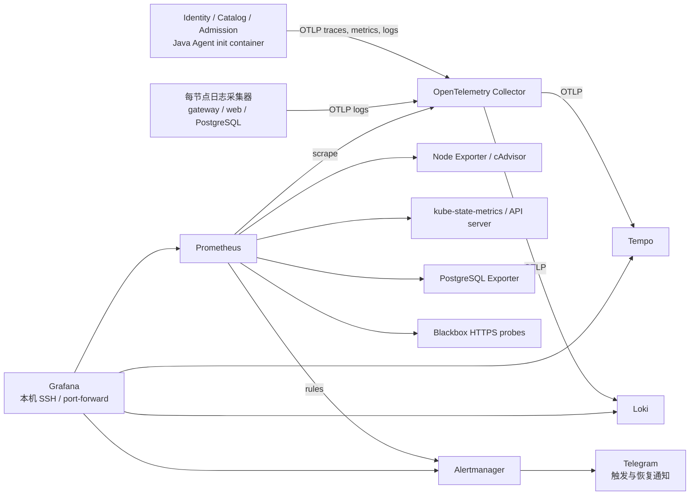

# K3s 监控、日志、告警与追踪

正式站点的可观测性运行于现有两台 EC2 的 `observability` namespace，使用 containerd/Kubernetes。无需新增 EC2、EKS、负载均衡器或付费监控订阅。它使用现有节点的 CPU、内存和根 EBS 空间；当前业务 namespace `sems-test` 承载生产数据。

## 打开控制台

在项目目录执行并保持终端打开：

```bash
python3 scripts/observability/access.py
```

打开 <http://127.0.0.1:13000/d/sems-operations>。用户名和密码保存在本机 `.secrets/observability/grafana-login.txt`。脚本使用已有 SSH 私钥及专用 kubeconfig，仅绑定本机端口；不开放公网 Grafana、Prometheus、Loki、Tempo、OTLP 或 PostgreSQL 端口。退出终端会关闭该次通道；Grafana Pod 更新时会重连。

Grafana 的 **SEMS · Operations** 面板提供：

- 四条正式 HTTPS 健康检查、应用副本及当前告警。
- 两节点 CPU、可用内存、根磁盘、Pod CPU/内存和控制平面 API 请求延迟。
- 三个 Java 服务的请求速率、5xx、p95、JVM 堆/GC 和 JDBC 连接池。
- PostgreSQL 连接、锁、提交和死锁统计。
- Java OTLP 日志，以及 gateway、web、PostgreSQL 的新容器日志。

**Explore → Tempo** 可搜索服务或输入 Trace ID 查看瀑布图和单条链路的节点图。公开票种读取经过 `Admission → Event Catalog → Identity`，并包含 JDBC 调用。Loki 日志保留应用在请求上下文中产生的 Trace ID；没有业务日志输出的请求不会凭空生成日志。SQL 文本、URL 查询参数和异常详情在进入追踪存储前移除；不启用请求体、响应体或认证头采集。应用日志仍应遵守现有的不记录凭据/个人资料约定。

## 数据流与边界



`deployment/observability/` 独立于应用 CD 管理；所有镜像锁定摘要，见 `images.lock.json`。三个后端通过共享 Kustomize component 注入官方 Java Agent，不改变业务镜像、schema 或服务 API。后续 K3s 应用发布会保留 Agent；监控故障时，异步导出使用有限队列，不应成为业务调用的同步依赖。

Grafana、Prometheus、Loki、Tempo 和 Alertmanager 各一实例。两台节点各一个 Node Exporter 和日志采集器。API server 通过 ServiceAccount/TLS 认证采集；Prometheus 有读取节点/Pod 和节点 metrics proxy 的权限，不可读取 Secret。数据库使用独立 `sems_monitor` 登录角色及 `pg_monitor`，默认只读，不授予业务 schema 查询权限。NetworkPolicy 仅允许应用进入 Collector 的 OTLP 端口，以及指定数据库 exporter 连接 PostgreSQL。

## 告警与 Telegram

规则见 [rules.yml](../deployment/observability/config/rules.yml)：入口故障、采集失败、Node NotReady、应用副本缺失、重复重启、PostgreSQL 连接失败、节点 CPU/内存/磁盘、数据库连接数、连接池持续等待、证书到期、5xx 和 p95。错误率/延迟规则要求五分钟至少 20 次请求，避免少量请求触发比例误报。阈值用于运维，不代表已经达到相同数值的性能承诺。

Prometheus 计算 pending/firing，Alertmanager 分组并向 Telegram 发送 firing/resolved。Grafana 面板显示当前规则状态，**Alerting** 中选择外部 Alertmanager 查看告警和静默。没有 firing 告警时，告警表为空是正常情况。规则保存在代码中；UI 中的临时静默不是规则修改。

Telegram Token 和 Chat ID 仅在本机 `.secrets/observability/telegram.env` 保存：

```dotenv
TELEGRAM_BOT_TOKEN=
TELEGRAM_CHAT_ID=
```

填入现有机器人的实际值后执行：

```bash
python3 scripts/observability/manage.py --kubeconfig .secrets/k3s-cloud/kubeconfig telegram
```

脚本先只读验证 bot/chat，再将 Token 和接收配置写入 Kubernetes Secret，Token 以文件挂载；不放进 ConfigMap、Git、镜像或命令行。首次部署默认仅面板告警，避免向未经配置的渠道发送消息。再次安装会保留已配置的接收 Secret，不会恢复为无通知模式。Token 轮换后重新执行此命令。

## 安装与验证

管理脚本需要 Python 3 + PyYAML、kubectl 和当前专用 SSH/kubeconfig。先验证，再安装独立监控组件：

```bash
python3 scripts/observability/validate.py
python3 scripts/observability/manage.py --kubeconfig .secrets/k3s-cloud/kubeconfig install
```

`validate.py` 用锁定容器验证 Prometheus/Alertmanager/Loki/Tempo/Collector 配置，并测试告警保持时间、5xx 触发和低流量/404 不误报；仅挂载配置目录，不接触生产数据或工作区凭据。CI integration 也运行此检查。

首次为现有应用接入 Agent 时，以下脚本会通过已有 SSH 连接持有 server 的 `/var/lib/sems-cd/deploy.lock`，与 CD 串行；锁占用时拒绝修改应用。也可在 PR 合并后通过正常 main CD 发布同一 component。不要直接 apply 带历史镜像摘要的整个 K3s bootstrap overlay：

```bash
python3 scripts/observability/manage.py --kubeconfig .secrets/k3s-cloud/kubeconfig instrument
```

脚本保存原 Deployment 模板，依次滚动三个服务，只改 Agent/init volume/采集环境变量，保留现场镜像及两副本。单个服务无法就绪时恢复该服务的原模板并停止。它不恢复数据库、不会将先前成功接入的服务全部回退。普通应用回退到 Agent 接入前的已验证 release 也会移除采集，应在恢复业务后重新接入。

只读验证及显式告警自测：

```bash
python3 scripts/observability/verify.py --kubeconfig .secrets/k3s-cloud/kubeconfig \
  --report .secrets/observability/verification.json
python3 scripts/observability/verify.py --kubeconfig .secrets/k3s-cloud/kubeconfig \
  --alert-smoke --report .secrets/observability/alert-verification.json
```

自测仅向 Collector 写一条明确标记的合成 gauge，让真实规则进入 firing，再将 gauge 清零，验证 Alertmanager 及已配置 Telegram 的触发/恢复投递计数。它不会停止应用、删除 Pod、创建订单或更改业务表。通知会标记 `ObservabilitySmokeTest`。普通验证只发送公开 GET 和 sampled traceparent，并检查三个服务的 parent/span 关系及查询文本已移除。

## 容量与保留

| 数据 | 配置 | 存储 |
| --- | --- | --- |
| 指标 | 30 秒抓取；48 小时或 512 MB TSDB 保留上限 | server 本地 PVC |
| 日志 | 48 小时；低吞吐限流与有限重试队列 | worker 本地 PVC |
| 追踪 | 根请求 10% 采样，继承父采样决定；24 小时 | worker 本地 PVC |
| Grafana / Alertmanager | 面板/用户配置、静默和通知状态 | server 本地 PVC |

组件均设置 CPU/内存 requests/limits。PVC 使用 Retain 的 local-path 存储，容量声明不是文件系统配额，也不会额外创建收费 EBS；数据占用现有根盘。日志/追踪的删除存在延迟，不能把保留时间当作严格磁盘上限。磁盘低于 20% 会报警。镜像层、K3s 日志及 PostgreSQL 也共享根盘，需要一起观察。

该规模适合当前小流量部署。它不提供监控后端高可用、异地保存、独立于集群的外部告警、AWS CPU credit/账单指标或节点自动扩容。整个集群/控制平面故障时，栈内探测和通知也可能失效；后续若需要主机级独立故障通知，再单独接外部探测/CloudWatch。不要将当前指标快照替代正式负载或灾难恢复测试。
